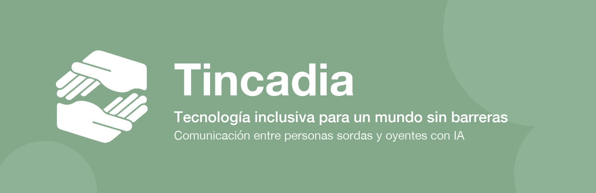

  

  
  
  

## 🤝 Quiénes somos

**Tincadia** crea puentes de comunicación para un mundo más inclusivo. Desarrollamos soluciones tecnológicas accesibles, con inteligencia artificial y herramientas de comunicación que conectan a personas sordas, oyentes y organizaciones.

## ✨ Qué construimos

| | |
|---|---|
| 🖐️ **Reconocimiento de lengua de señas** | Modelos de IA que interpretan la Lengua de Señas Colombiana (LSC) en tiempo real. |
| 🎙️ **Transcripción de voz** | Conversión de voz a texto para que nadie se quede fuera de una conversación. |
| 💬 **Comunicación accesible** | Chat, contactos y llamadas pensados para personas sordas y oyentes. |
| 🚨 **Emergencias** | Acceso rápido a servicios de emergencia sin barreras de comunicación. |

## 🛠️ Tecnología

  
  
  
  
  
  
  
  

---

  Hecho en Colombia 🇨🇴 con el propósito de que la comunicación sea un derecho para todas las personas.

